<div align="center">

<a href="https://xsodatv.com" target="_blank">
  <picture>
    <source media="(prefers-color-scheme: dark)" srcset="assets/brand/sodatv-mascot-dark.png">
    
  </picture>
</a>

# SodaTV

### 一个想法，一整支 AI 剧组，一部完整的片子

中文 / [English](README_EN.md)

<a href="https://xsodatv.com">官网</a> · <a href="https://xsodatv.com">在线使用</a> · <a href="#示例作品">示例作品</a> · <a href="#一键成片">一键成片</a> · <a href="#模型与-api-key">自备 API Key</a> · <a href="https://github.com/burning0xb-creator/xsodatv/issues">Issues</a>

<p>
  <a href="https://xsodatv.com"></a>
  <a href="#ai-剧组"></a>
  <a href="https://github.com/burning0xb-creator/xsodatv"></a>
  <a href="https://github.com/burning0xb-creator/xsodatv/issues"></a>
  <a href="https://github.com/burning0xb-creator/xsodatv/commits/main"></a>
</p>

</div>

***

## SodaTV 是什么

SodaTV 是一个 AI 视频创作平台，专门为「讲完一个故事」设计。

多数 AI 视频工具给你一个输入框，一次出几秒钟的片段，剩下的全靠你自己拼。SodaTV 给你的是一整支剧组：从一句话的想法开始，编剧、导演、美术、分镜、剪辑各司其职，把它做成一部有头有尾、人物前后一致的片子。

<a href="https://www.xsodatv.com" target="_blank">
  
</a>

无需安装或部署，打开 **[xsodatv.com](https://www.xsodatv.com)** 即可直接在线体验。

## 为什么选 SodaTV

- **一个想法就能开始。** 不用会写剧本。Agent 像采访一样和你聊故事、主角、风格和时长，再写出完整剧本。已有剧本可以直接导入，也可以给一段参考片让它照着改。→ [完整示例](#从创意到成片一个完整示例)
- **一整支 AI 剧组。** 23 个制作岗位、40 位导演、24 位编剧。剧本统筹、视觉总监、角色造型、服装、妆造、场景、道具、分镜导演、剪辑指导、一致性检查员……每个岗位只管自己那一摊，像真实剧组一样分工协作。→ [AI 剧组](#ai-剧组)
- **按题材挑导演和编剧。** 每部剧开工前，制片统筹按题材聘 1～3 位导演和对应的编剧组，不同段落交给擅长那类戏的导演来定分镜和表演。→ [导演组与编剧组](#ai-剧组)
- **人物从头到尾不走样。** 角色和场景先出定妆母版，你点「主选」定下来，之后每一个镜头都照着它出；一致性检查员再把全剧过一遍。→ [资产册](#更多能力)
- **改一处，只重做一处。** 剧本展开成「集 → 段 → 镜」三级结构。改一句台词，只需要重新编译、重新生成那一段，不用整部重来。
- **不想一步步做？一键成片。** 热点新闻、玄幻讲解、主题动画（Remotion），给一个题目，直接出成片。→ [一键成片](#一键成片)
- **20 多种题材开箱即用。** 仙侠、情感、都市、科幻、学龄前动画、废土神话、格林童话、安全警示、通用科普、回忆录，以及美妆、食品、服饰、家居、数码、宠物、房产、农产品、农资、农机等十几类广告和通用宣传片。
- **模型随你选。** 直接用平台模型按气泡计费，或者填自己的火山引擎、Soda 通道（OpenRouter）、MiniMax、火山联网搜索、阿里云百炼 Key，走自己的额度。→ [模型与 API Key](#模型与-api-key)

一部片子在 SodaTV 里是这样组织的：

```
一部片子
├── 剧本：Agent 采访 → 剧本 → 剧本圣经
├── 制作设计：视觉风格 · 角色 · 服装 · 妆造 · 场景 · 道具
├── 资产册：定妆母版（点「主选」）→ 侧面 · 背面 · 其他视角
├── 分镜表
│   ├── 第 1 集
│   │   ├── 第 1 段：镜 1 · 镜 2 · 镜 3   ← 改一句台词，只重做这一段
│   │   └── 第 2 段：镜 1 · 镜 2
│   └── 第 2 集 …
└── 画布出片：分段视频 → 合成成片
```

## AI 剧组

一部片子由三拨人一起做：23 个各管一摊的制作岗位、40 位导演、24 位编剧。制作过程中，你能在任务面板里看到此刻是谁在干什么。

<details open>
<summary><strong>制作岗位（23 个）</strong></summary>

**剧本与统筹**（4 位）

<table>
  <tr>
    <td align="center" valign="top" width="150">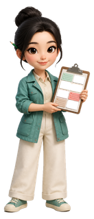<br><b>剧本统筹</b><br><sub>拆分剧本，建立剧本圣经</sub></td>
    <td align="center" valign="top" width="150"><br><b>编剧统筹</b><br><sub>清点每个人物的对白</sub></td>
    <td align="center" valign="top" width="150"><br><b>参考分析师</b><br><sub>读懂你给的参考图和参考片</sub></td>
    <td align="center" valign="top" width="150"><br><b>制片统筹</b><br><sub>组建创作班底，清点生产资产</sub></td>
  </tr>
</table>

**美术设计**（8 位）

<table>
  <tr>
    <td align="center" valign="top" width="150">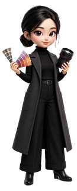<br><b>视觉总监</b><br><sub>定下全片视觉风格</sub></td>
    <td align="center" valign="top" width="150"><br><b>角色造型设计师</b><br><sub>设计角色外形</sub></td>
    <td align="center" valign="top" width="150"><br><b>服装设计师</b><br><sub>设计每个角色的服装</sub></td>
    <td align="center" valign="top" width="150"><br><b>妆造师</b><br><sub>设计妆容和发型</sub></td>
  </tr>
  <tr>
    <td align="center" valign="top" width="150"><br><b>饰品设计师</b><br><sub>设计饰品</sub></td>
    <td align="center" valign="top" width="150">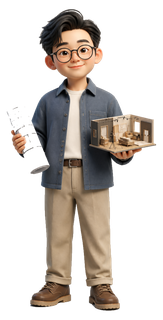<br><b>场景美术设计师</b><br><sub>设计场景环境</sub></td>
    <td align="center" valign="top" width="150">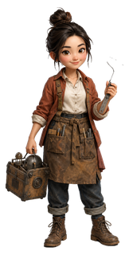<br><b>道具设计师</b><br><sub>设计关键道具</sub></td>
    <td align="center" valign="top" width="150">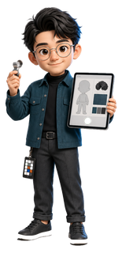<br><b>资产外观核对师</b><br><sub>以你选定的定妆图为准核对外观</sub></td>
  </tr>
</table>

**镜头与剪辑**（7 位）

<table>
  <tr>
    <td align="center" valign="top" width="150">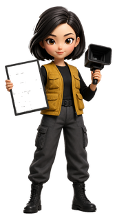<br><b>分镜导演</b><br><sub>设计分镜</sub></td>
    <td align="center" valign="top" width="150"><br><b>镜头精写师</b><br><sub>逐镜写清画面和表演</sub></td>
    <td align="center" valign="top" width="150"><br><b>首帧工程师</b><br><sub>写好每一镜的首帧画面</sub></td>
    <td align="center" valign="top" width="150"><br><b>剪辑指导</b><br><sub>设计分场，校准段与段的衔接</sub></td>
  </tr>
  <tr>
    <td align="center" valign="top" width="150">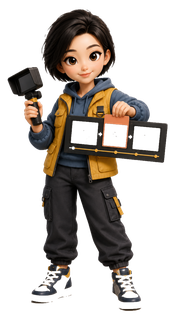<br><b>补拍导演</b><br><sub>补上缺的镜头</sub></td>
    <td align="center" valign="top" width="150"><br><b>视频提示词工程师</b><br><sub>把分镜汇编成视频提示词</sub></td>
    <td align="center" valign="top" width="150">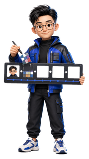<br><b>视频提示词校订员</b><br><sub>定妆换了，只改外观描写</sub></td>
  </tr>
</table>

**质量把关**（2 位）

<table>
  <tr>
    <td align="center" valign="top" width="150">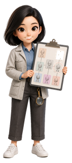<br><b>角色一致性检查员</b><br><sub>检查全剧角色有没有走样</sub></td>
    <td align="center" valign="top" width="150"><br><b>原文一致性修订师</b><br><sub>对照原文修订不一致的地方</sub></td>
  </tr>
</table>

**一键成片**（2 位）

<table>
  <tr>
    <td align="center" valign="top" width="150"><br><b>新闻研究员</b><br><sub>查找公开报道，整理事实</sub></td>
    <td align="center" valign="top" width="150">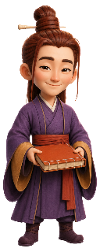<br><b>玄幻考据员</b><br><sub>查典籍与传说出处</sub></td>
  </tr>
</table>

</details>

<details open>
<summary><strong>导演组（40 位）</strong>：开工前按题材聘 1～3 位，不同段落交给擅长那类戏的导演</summary>

**电影叙事**（18 位）

<table>
  <tr>
    <td align="center" valign="top" width="150"><br><b>斯皮尔伯格</b><br><sub>场面调度与情绪清晰</sub></td>
    <td align="center" valign="top" width="150">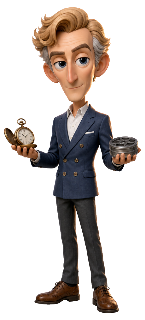<br><b>克里斯托弗·诺兰</b><br><sub>时间结构与交叉剪辑</sub></td>
    <td align="center" valign="top" width="150">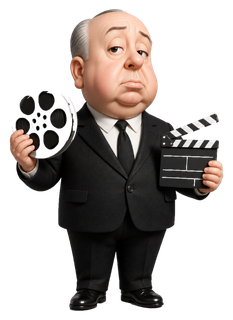<br><b>希区柯克</b><br><sub>悬念语法</sub></td>
    <td align="center" valign="top" width="150"><br><b>大卫·芬奇</b><br><sub>精准与冷感</sub></td>
    <td align="center" valign="top" width="150">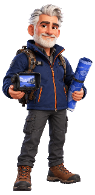<br><b>卡梅隆</b><br><sub>机械动作与倒计时</sub></td>
  </tr>
  <tr>
    <td align="center" valign="top" width="150">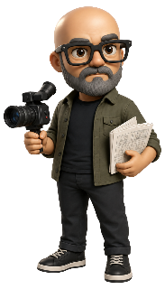<br><b>丹尼斯·维伦纽瓦</b><br><sub>巨物与静默</sub></td>
    <td align="center" valign="top" width="150">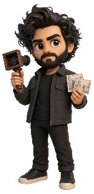<br><b>罗伯特·艾格斯</b><br><sub>民间故事的写实底</sub></td>
    <td align="center" valign="top" width="150"><br><b>马提欧·加洛尼</b><br><sub>把童话当真事拍</sub></td>
    <td align="center" valign="top" width="150">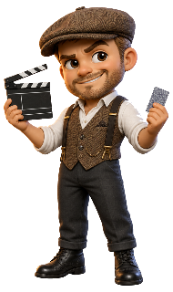<br><b>盖·里奇</b><br><sub>群像斗法</sub></td>
    <td align="center" valign="top" width="150">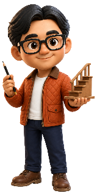<br><b>奉俊昊</b><br><sub>阶层与空间的上下</sub></td>
  </tr>
  <tr>
    <td align="center" valign="top" width="150"><br><b>是枝裕和</b><br><sub>日常生活流</sub></td>
    <td align="center" valign="top" width="150"><br><b>岩井俊二</b><br><sub>逆光与青春</sub></td>
    <td align="center" valign="top" width="150"><br><b>张艺谋</b><br><sub>色彩块面与仪式感</sub></td>
    <td align="center" valign="top" width="150"><br><b>王家卫</b><br><sub>情绪与氛围</sub></td>
    <td align="center" valign="top" width="150"><br><b>李安</b><br><sub>克制的家庭戏</sub></td>
  </tr>
  <tr>
    <td align="center" valign="top" width="150">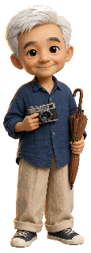<br><b>侯孝贤</b><br><sub>门框里的固定长镜</sub></td>
    <td align="center" valign="top" width="150">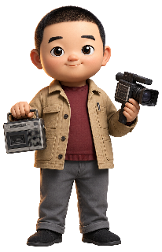<br><b>贾樟柯</b><br><sub>车站街口的固定全景</sub></td>
    <td align="center" valign="top" width="150">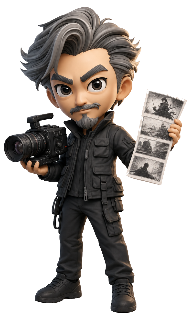<br><b>徐克</b><br><sub>动势与奇观</sub></td>
  </tr>
</table>

**广告**（10 位）

<table>
  <tr>
    <td align="center" valign="top" width="150">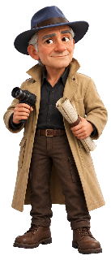<br><b>Ridley Scott</b><br><sub>产品英雄镜</sub></td>
    <td align="center" valign="top" width="150"><br><b>Spike Jonze</b><br><sub>空间随情绪变形</sub></td>
    <td align="center" valign="top" width="150">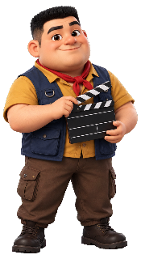<br><b>Tom Kuntz</b><br><sub>对镜独白一镜到底</sub></td>
    <td align="center" valign="top" width="150"><br><b>Dougal Wilson</b><br><sub>等待本身就是戏</sub></td>
    <td align="center" valign="top" width="150"><br><b>Jake Scott</b><br><sub>同一个动作重复三次</sub></td>
  </tr>
  <tr>
    <td align="center" valign="top" width="150"><br><b>Joe Wright</b><br><sub>长镜跟着人做决定</sub></td>
    <td align="center" valign="top" width="150"><br><b>Sofia Coppola</b><br><sub>自然光下的自在</sub></td>
    <td align="center" valign="top" width="150"><br><b>Sølve Sundsbø</b><br><sub>质地是主角</sub></td>
    <td align="center" valign="top" width="150">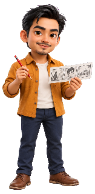<br><b>Thanonchai Sornsriwichai</b><br><sub>日常善意不解释</sub></td>
    <td align="center" valign="top" width="150"><br><b>张大鹏</b><br><sub>土物件进高级镜头</sub></td>
  </tr>
</table>

**纪录片与讲解**（5 位）

<table>
  <tr>
    <td align="center" valign="top" width="150">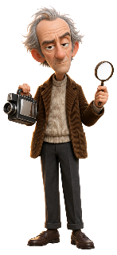<br><b>Errol Morris</b><br><sub>黑幕前打光的物证</sub></td>
    <td align="center" valign="top" width="150">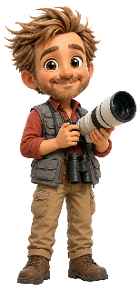<br><b>Alastair Fothergill</b><br><sub>耐心的建立镜与微距</sub></td>
    <td align="center" valign="top" width="150">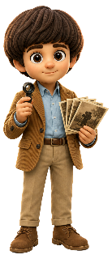<br><b>Ken Burns</b><br><sub>静物上的推与摇</sub></td>
    <td align="center" valign="top" width="150">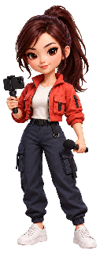<br><b>达人口播</b><br><sub>信息流博主对镜说</sub></td>
    <td align="center" valign="top" width="150">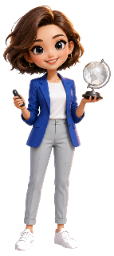<br><b>讲解者原型</b><br><sub>对镜讲解不叫卖</sub></td>
  </tr>
</table>

**动画与儿童**（7 位）

<table>
  <tr>
    <td align="center" valign="top" width="150">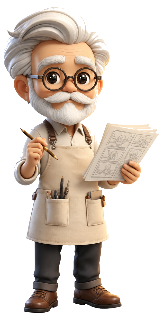<br><b>宫崎骏</b><br><sub>风与飞行、自然的尺度</sub></td>
    <td align="center" valign="top" width="150"><br><b>Pete Docter</b><br><sub>把抽象概念变成角色</sub></td>
    <td align="center" valign="top" width="150">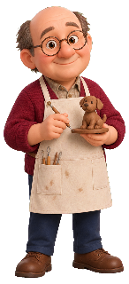<br><b>Nick Park</b><br><sub>真人口吻配到动物身上</sub></td>
    <td align="center" valign="top" width="150">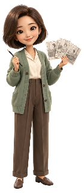<br><b>温柔日常流</b><br><sub>学龄前日常小事</sub></td>
  </tr>
  <tr>
    <td align="center" valign="top" width="150">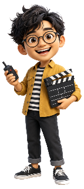<br><b>憨态逗趣</b><br><sub>无害滑稽</sub></td>
    <td align="center" valign="top" width="150">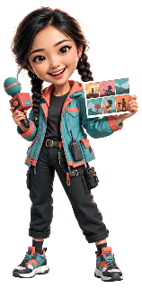<br><b>童谣互动</b><br><sub>重复句式，跟着一起动</sub></td>
    <td align="center" valign="top" width="150"><br><b>柔光奇趣</b><br><sub>想象具象化</sub></td>
  </tr>
</table>

</details>

<details open>
<summary><strong>编剧组（24 位）</strong>：同样按题材挑人，负责剧本的改编和台词</summary>

**影视剧本**（6 位）

<table>
  <tr>
    <td align="center" valign="top" width="150">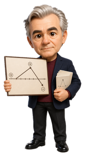<br><b>罗伯特·麦基</b><br><sub>每场都有价值转变</sub></td>
    <td align="center" valign="top" width="150">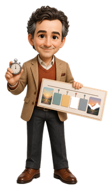<br><b>布莱克·斯奈德</b><br><sub>节拍表</sub></td>
    <td align="center" valign="top" width="150"><br><b>亚伦·索金</b><br><sub>对白即动作</sub></td>
  </tr>
  <tr>
    <td align="center" valign="top" width="150"><br><b>昆汀·塔伦蒂诺</b><br><sub>观众知道而角色不知道</sub></td>
    <td align="center" valign="top" width="150"><br><b>刘和平</b><br><sub>潜台词与权力博弈</sub></td>
    <td align="center" valign="top" width="150">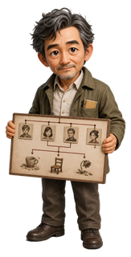<br><b>芦苇</b><br><sub>情节从性格里长出来</sub></td>
  </tr>
</table>

**广告文案**（8 位）

<table>
  <tr>
    <td align="center" valign="top" width="150">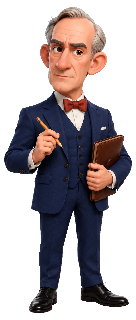<br><b>David Ogilvy</b><br><sub>卖点必须可核实</sub></td>
    <td align="center" valign="top" width="150">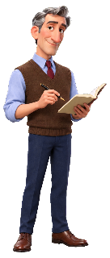<br><b>Bill Bernbach</b><br><sub>一个洞察一句话</sub></td>
    <td align="center" valign="top" width="150">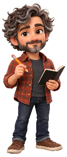<br><b>Dan Wieden</b><br><sub>说观众的事</sub></td>
    <td align="center" valign="top" width="150"><br><b>Ilon Specht</b><br><sub>第一人称态度句</sub></td>
  </tr>
  <tr>
    <td align="center" valign="top" width="150"><br><b>Shirley Polykoff</b><br><sub>俏皮说出心里话</sub></td>
    <td align="center" valign="top" width="150"><br><b>许舜英</b><br><sub>说一种活法</sub></td>
    <td align="center" valign="top" width="150">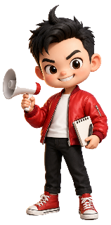<br><b>东东枪</b><br><sub>广告是说话不是写字</sub></td>
    <td align="center" valign="top" width="150">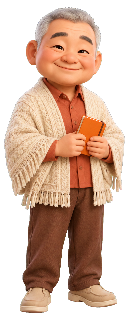<br><b>糸井重里</b><br><sub>柔软的日常口语</sub></td>
  </tr>
</table>

**科普与非虚构**（5 位）

<table>
  <tr>
    <td align="center" valign="top" width="150"><br><b>理查德·费曼</b><br><sub>第一性原理加类比</sub></td>
    <td align="center" valign="top" width="150"><br><b>卡尔·萨根</b><br><sub>把你放到宇宙的尺度上</sub></td>
    <td align="center" valign="top" width="150"><br><b>兰道尔·门罗</b><br><sub>认真推演荒唐的假设</sub></td>
    <td align="center" valign="top" width="150"><br><b>史蒂文·约翰逊</b><br><sub>发明从「旁边」长出来</sub></td>
    <td align="center" valign="top" width="150">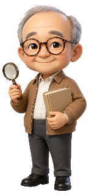<br><b>叶永烈</b><br><sub>从孩子的问题起手</sub></td>
  </tr>
</table>

**散文与回忆录**（5 位）

<table>
  <tr>
    <td align="center" valign="top" width="150"><br><b>朱自清</b><br><sub>一段只写一个动作</sub></td>
    <td align="center" valign="top" width="150">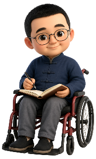<br><b>史铁生</b><br><sub>靠一个地方写一个人</sub></td>
    <td align="center" valign="top" width="150"><br><b>龙应台</b><br><sub>第二人称两头写</sub></td>
    <td align="center" valign="top" width="150"><br><b>安妮·埃尔诺</b><br><sub>从一张照片写起</sub></td>
    <td align="center" valign="top" width="150"><br><b>娜塔莉亚·金兹伯格</b><br><sub>家里反复说的话就是家史</sub></td>
  </tr>
</table>

</details>

> 导演和编剧档案是我们根据各位创作者公开作品的风格整理的创作方法，用来指导分镜、表演和写作。它们与本人没有关联，也不代表本人认可或参与。
>
> **版权提示**：以上 87 个 AI 剧组 Q 版角色立绘均为 SodaTV 原创设计，版权归 SodaTV 所有（All Rights Reserved）。未经书面授权，禁止复制、转载、二创、商用或用于模型训练，详见 [LICENSE](LICENSE)。

## 一键成片

不想一步步做，就用一键成片：在画布上点「一键成片」，选一种玩法，给一个题目，剩下的交给剧组。

| 玩法 | 你给什么 | 你得到什么 |
| --- | --- | --- |
| **热点新闻** | 一个你关心的话题 | 整理公开报道、写口播稿并标注出处，AI 主播播报，配上画面和字幕，出一条竖屏快讯 |
| **玄幻讲解** | 一个神话或传说 | 讲成一个有头有尾的故事，逐段配国风插画并让画面动起来，支持竖屏（9:16）与横屏（16:9），旁白、音效、字幕一起出 |
| **主题动画（画布菜单中叫 `Remotion`）** | 一个主题 | 联网查资料、写文案，再现场写一段动画；每一单的配色和视觉风格都不一样 |

<table>
<tr>
<td width="33%" valign="top">

https://github.com/user-attachments/assets/6ecdc2a3-fe9d-4afa-97e1-9cc1bc9aaae5

<h3>🗡️ 黄粱一梦：吕洞宾求道</h3>
<p><sub>玄幻讲解 · 122 秒竖屏</sub></p>
<p>书生吕岩赶考途经邯郸道黄化店，遇钟离权点化却执意求官；一锅黄粱未熟，梦中历尽高中状元、荣华富贵与雪夜遭劫、骨肉离散，醒来方知梦中人皆是钟离权所化。角色造型、国风画面、旁白、音效与字幕全自动完成。</p>

</td>
<td width="33%" valign="top">

https://github.com/user-attachments/assets/d1a90768-a801-4827-8f75-17fdaef3be24

<h3>🐉 河图洛书：龙马与神龟</h3>
<p><sub>玄幻讲解 · 98 秒竖屏</sub></p>
<p>龙马驮图出黄河、伏羲照着河图画八卦、神龟背书出洛水、大禹依洛书定下九章大法。一个上古传说从头讲到尾，国风插画、画面动效、旁白、字幕和小标题都是自动完成的。</p>

</td>
<td width="33%" valign="top">

https://github.com/user-attachments/assets/1a7323b7-dd67-4d92-bd14-208a1954f1b1

<h3>📰 佛州公务机坠毁最新进展</h3>
<p><sub>热点新闻 · 118 秒竖屏</sub></p>
<p>汇总多家公开报道写成口播稿，AI 主播播报。各家说法不一的地方并列给出，事件经过、调查进展、影响分段讲清；现场画面来自公开报道，信息卡、航迹图和字幕自动生成。</p>

</td>
</tr>
<tr>
<td colspan="3" valign="top">

https://github.com/user-attachments/assets/09e201d7-47fc-4d2e-8e92-4b8f26e42abe

<h3>🫏 张果老：一头能折起来的白驴</h3>
<p><sub>玄幻讲解 · 128 秒横屏（16:9）</sub></p>
<p>隐居中条山的张果倒骑白驴、日行数百里，休歇时便把白驴折成纸片收进随身箱中；武则天派使征召，他在妒女庙前倒地装死又于恒州山中复现；唐玄宗遣使迎请，他当面气绝、焚香宣诏后方才苏醒，终乘轿应召入东都洛阳。支持 16:9 横屏一键成片，角色形象、场景、旁白、音效与字幕自动连贯生成。</p>

</td>
</tr>
</table>

## 从创意到成片：一个完整示例

下面是短片《云海来客》从一个念头到成片的五步。故事很简单：一个飞行员女孩带着她的小狗，驾着飞艇穿过云海，遇见一座浮空城堡。

<table>
  <tr>
    <td width="42%">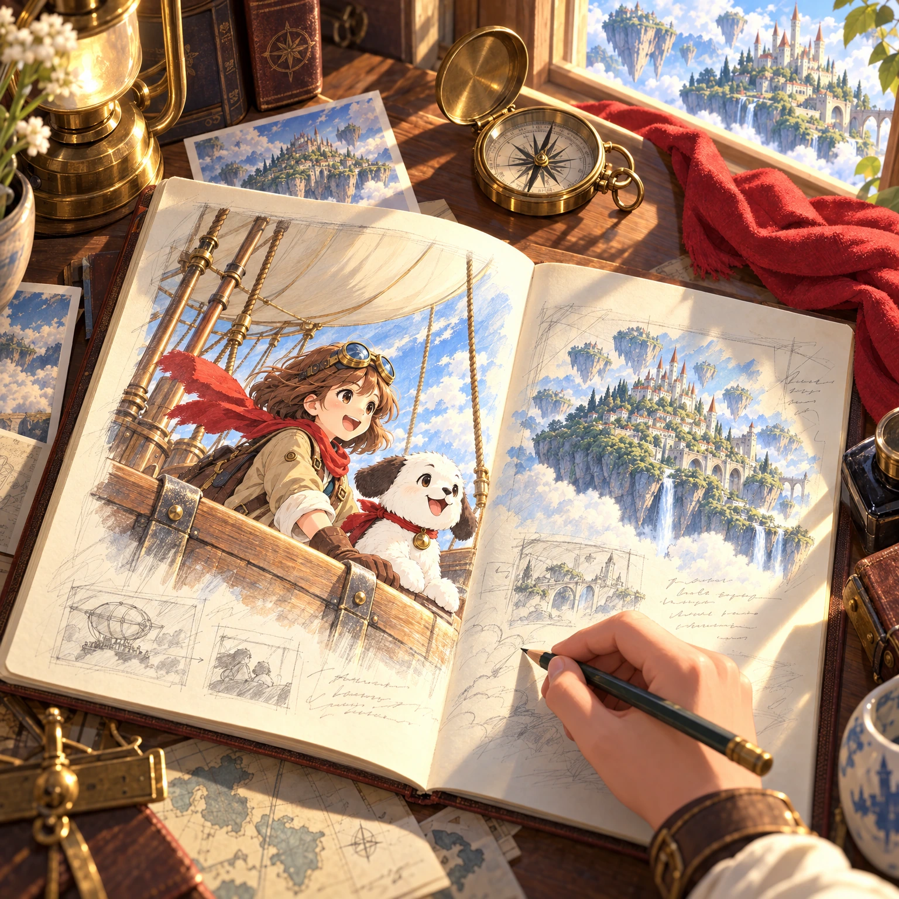</td>
    <td>
      <h3>1. 创意剧本</h3>
      <p>告诉 Agent「一个女孩和她的小狗坐飞艇去冒险」。它会追问主角是谁、想要什么风格、片子多长，再根据你的回答写出剧本。</p>
      <p>你检查人物动机、情节转折和台词，把故事先定下来。</p>
      <p><b>得到：</b>一份可以继续设计的剧本。</p>
    </td>
  </tr>
  <tr>
    <td>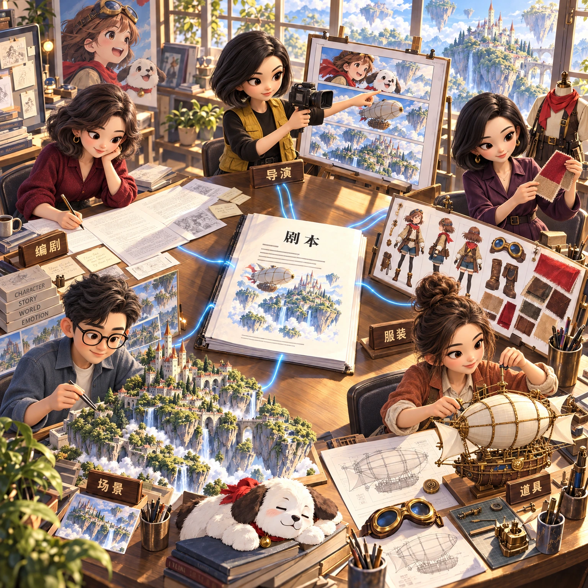</td>
    <td>
      <h3>2. AI 剧组读剧本</h3>
      <p>导演和编剧梳理剧情、人物关系和情绪节奏；服装、场务、道具分别细化女孩的飞行装、小狗的项圈、飞艇和浮空城堡。</p>
      <p>先定整体风格和画面质感，各部门朝同一个视觉方向设计。</p>
      <p><b>得到：</b>一份风格统一的制作设计和资产清单。</p>
    </td>
  </tr>
  <tr>
    <td>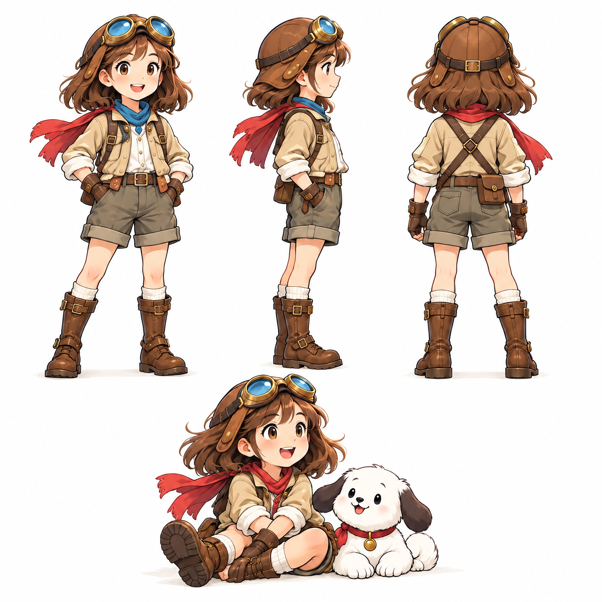</td>
    <td>
      <h3>3. 资产册定妆</h3>
      <p>先为女孩和小狗生成转身表候选，挑一张点「主选」。之后的侧面、背面和每一个镜头都照着这张图出。</p>
      <p>对造型不满意，可以改资产提示词重新生成。</p>
      <p><b>得到：</b>贯穿整部片的角色与场景参考。</p>
    </td>
  </tr>
  <tr>
    <td>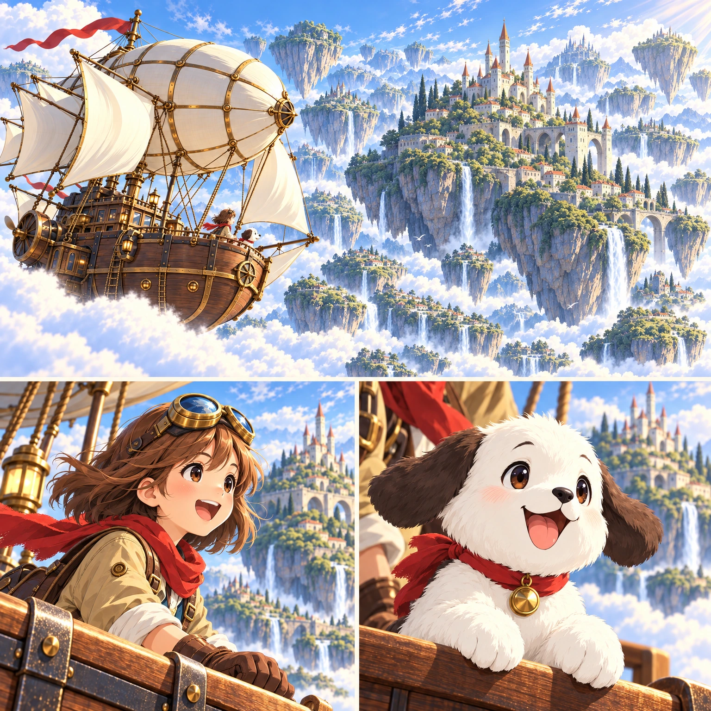</td>
    <td>
      <h3>4. 分镜表</h3>
      <p>剧本展开成分段与镜头：远景交代云海和飞艇，近景接女孩的台词，特写给小狗的反应。</p>
      <p>不满意的镜头直接改，改完点「编译本段」。出片前可以先看分镜预览图，检查构图和角色对不对。</p>
      <p><b>得到：</b>一份可编辑、可预览的分镜表。</p>
    </td>
  </tr>
  <tr>
    <td>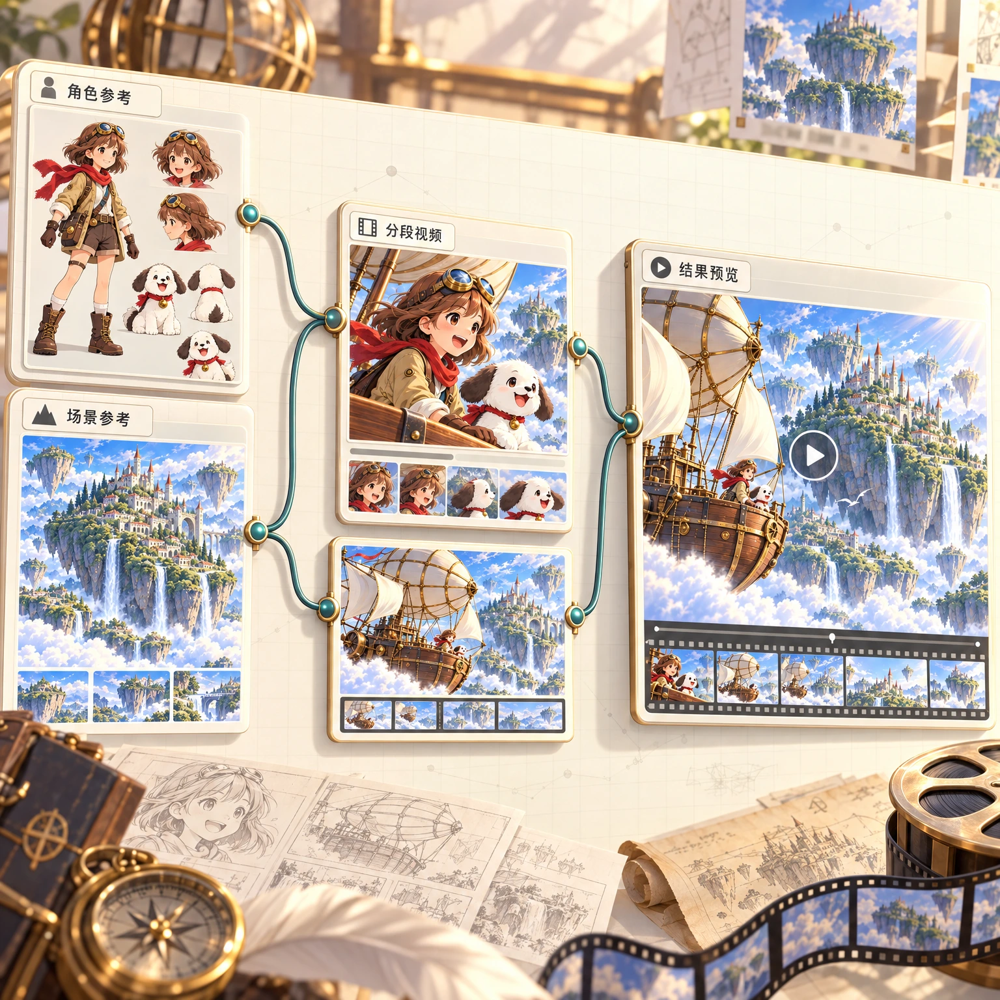</td>
    <td>
      <h3>5. 画布出片</h3>
      <p>把分段加到画布，角色参考和场景参考连到视频节点，确认提示词后生成。</p>
      <p>逐段检查人物、动作和镜头衔接，不满意的调整后重做，最后合成。</p>
      <p><b>成片：</b>见下方 <a href="#示例作品">示例作品中的《云海来客》（5 秒）</a>，可直接在页面内播放。</p>
    </td>
  </tr>
</table>

**第一次用的建议**：从角色少、场景集中的短故事开始；先打磨好一个分段，确认风格和节奏后再做其他分段。

## 示例作品

以下视频都由 SodaTV 生成，属于 AI 生成内容，可直接在页面内点击播放。

<table>
<tr>
<td width="270" valign="top">

https://github.com/user-attachments/assets/283ce08e-3cfd-4388-851b-575828ee4d7c

<p><b>叶子里的绿色厨房</b> · 儿童科普动画 · 86 秒有声短片</p>
<p>小主持人拿着一片绿叶登上科普小剧场，带小朋友看清水如何一路送进树干与枝叶、在叶子里的「绿色厨房」完成光合作用。全片多镜头切换下人物形象、服装与舞台保持高度一致。</p>

</td>
<td width="270" valign="top">

https://github.com/user-attachments/assets/0205769e-45f9-4643-9467-96b193ced02c

<p><b>橘猫的移动王座</b> · 趣味动画 · 22 秒有声短片</p>
<p>把扫地机器人变成专属座驾，一只橘猫在客厅里展开慵懒又神气的冒险。</p>

</td>
<td width="270" valign="top">

https://github.com/user-attachments/assets/0b369b74-2265-413e-88a9-f116b378be16

<p><b>云端重逢</b> · 未来叙事 · 12 秒有声短片</p>
<p>穿过落日下的空中车站，在车门前停下脚步，一次近在咫尺的重逢。</p>

</td>
</tr>
<tr>
<td width="270" valign="top">

https://github.com/user-attachments/assets/f3548fda-9a05-4ddc-873e-a53af6ab054e

<p><b>云海来客</b> · 冒险动画 · 5 秒有声短片</p>
<p>飞艇擦过迎面的浮石，前方城堡的巨门缓缓打开。上面完整示例做的就是这一部。</p>

</td>
<td width="270" valign="top">

https://github.com/user-attachments/assets/225e0c04-edae-4639-9eb1-d38c06b22c15

<p><b>起跑之后</b> · 运动广告 · 6 秒有声短片</p>
<p>跑鞋压入浅水、蹬地加速，低机位跟拍让力量落在每一次触地。</p>

</td>
<td width="270" valign="top">

https://github.com/user-attachments/assets/3b04d3f8-3faa-4a83-b404-44d3ffb28bd5

<p><b>风经过夏天</b> · 商业广告 · 5 秒有声短片</p>
<p>夕阳下一阵风掠过发丝，她循着草地上的脚步声转头微笑。</p>

</td>
</tr>
<tr>
<td width="270" valign="top">

https://github.com/user-attachments/assets/29487a64-f3f7-4e84-82b5-a56404baa683

<p><b>大唐带货娘子</b> · 古装商战短剧 · 10 秒有声短片</p>
<p>第 1 集第 1 段：苏记香料铺柜台前，年轻掌柜抱账册与上门的富商针锋相对，人物口型、正反打镜头与唐风布景连贯自然。</p>

</td>
<td width="270" valign="top">

https://github.com/user-attachments/assets/d4ef688e-adde-4be5-9f51-b299494f9bc6

<p><b>这袋肥经得起查</b> · 农资广告 · 14 秒有声短片</p>
<p>从剧本一路做下来的农资广告第 1 集第 1 段：田间的老农捧起一把有机肥颗粒，对着镜头开讲。</p>

</td>
<td width="270" valign="top">

https://github.com/user-attachments/assets/2e35fcfd-7953-49bf-a715-2280a84e3acb

<p><b>动作迁移</b> · 画布工作流（内测中）· 10 秒有声短片</p>
<p>一张人物图加一段动作参考视频，画面里的人照着参考动作流畅跳完整段舞蹈，人物神态、服装与光线始终自然一致。</p>

</td>
</tr>
<tr>
<td width="270" valign="top">

https://github.com/user-attachments/assets/f5df9c5b-c2de-45a6-880c-28e248e78c16

<p><b>天空之海</b> · 电影感奇观 · 13 秒有声短片</p>
<p>雨后的城市街头，等红灯的女人抬头发现天空变成倒悬的海洋，一头巨鲸从摩天楼上方游过。</p>

</td>
<td width="270" valign="top">

https://github.com/user-attachments/assets/7ed84ce8-959f-4c5e-a4c1-64c84f81e1eb

<p><b>靠近之前，先清新</b> · 日常轻喜剧 · 15 秒有声广告</p>
<p>把睡前的一次靠近变成轻松的日常对话，十五秒讲完一个清新时刻。</p>

</td>
</tr>
</table>

## 更多能力

| 功能 | 你能做什么 |
| --- | --- |
| **节点画布** | 把角色、场景参考连到视频节点，在画布上生成、预览、重做，最后合成成片。 |
| **资产册** | 角色先出转身表、场景先出主镜位，点「主选」定下外观，再补侧面、背面和其他视角。也可以上传自己的图当定妆参考。 |
| **分镜表** | 改画面描述、台词和镜头安排，改完点「编译本段」；出片前能看分镜预览图和这一段还缺什么。 |
| **素材库** | 按文件夹整理素材。生成结果先留在画布上，挑中的才进素材库，不会被一批批候选图淹没。 |
| **多人协作** | 项目成员分「所有者 / 可编辑 / 只读」三种权限，可以在画布上评论，也能生成只读分享链接，随时撤销。 |

## 模型与 API Key

SodaTV 有两种用法，可以混着用：

| 用法 | 怎么开始 | 怎么计费 |
| --- | --- | --- |
| **直接用平台模型**（默认） | 注册登录就能用，不需要任何 Key | 按气泡计费，每次生成前会显示预估消耗 |
| **自备 API Key** | 账户中心 → 模型 API Key，填入自己的 Key | 填了 Key 的服务走你自己账号的额度，**不扣气泡**；费用由服务商直接向你收取 |

Key 是按服务商分开配置的。比如只填了火山引擎，走火山的生成用你的额度，其余照旧用平台模型、按气泡计费。

目前在**账户中心 → 账户 → 模型 API Key** 中支持配置以下 **5 张服务商卡片**：

| 卡片名称 | 用途说明 |
| --- | --- |
| **火山引擎** | 一把具备方舟与豆包语音权限的 API Key，同时覆盖火山方舟模型、语音识别（ASR）和语音合成（TTS） |
| **Soda 通道** | 可填写 OpenRouter 的 API Key，Soda 通道可复用 OpenRouter |
| **MiniMax** | 中国站开放平台 API Key，用于选择「MiniMax H3（官方直连）」视频生成（走「Soda 通道」的模型仍使用 Soda 通道 / OpenRouter 的 Key） |
| **火山联网搜索** | 豆包搜索 Custom 版专用 Key，用于热点新闻、主题动画等联网检索环节 |
| **阿里云百炼（一键成片配音）** | 用于一键成片的配音（玄幻讲解旁白、热点新闻女声）；火山语音 Key 不能替代它，未填写时配音仍按气泡计费 |

<details open>
<summary><strong>填写火山引擎 Key（方舟 + 豆包语音）</strong></summary>

1. 在火山 IAM 控制台创建 API Key，为所属用户授予方舟和豆包语音权限，并在控制台开通需要用到的模型及语音服务（已有方舟 Key 也可直接在 IAM 扩展语音权限）。
2. 登录 [xsodatv.com](https://xsodatv.com)，打开**账户中心 → 账户 → 模型 API Key**。
3. 在「火山引擎」卡片填入 API Key，点**保存并验证**。
4. 验证会分别检查方舟模型、语音识别和语音合成（合成会试合 1 个字，消耗极少额度，不扣气泡）。没通过时卡片会显示原因，多半是某项权限或模型未开通；补开后点**重新验证**即可。

</details>

<details>
<summary><strong>填写 Soda 通道（OpenRouter）Key</strong></summary>

1. 在 OpenRouter 创建 API Key，并确认账户里有余额。
2. 在**账户中心 → 账户 → 模型 API Key** 中找到 **「Soda 通道」** 卡片，填入你的 OpenRouter API Key（Soda 通道可复用 OpenRouter），点**保存并验证**。
3. 验证只查询 Key 状态，不生成内容。

</details>

<details>
<summary><strong>填写 MiniMax Key</strong></summary>

1. 登录 MiniMax 中国站开放平台控制台，进入「账户管理 / 接口密钥」创建 API Key，并确认已开通视频能力。
2. 在「MiniMax」卡片填入 Key，点**保存并验证**（验证只读查询音色，不生成视频；视频权限与余额在实际生成时检查）。
3. 出片时选择「MiniMax H3（官方直连）」即走这把 Key；选择「Soda 通道」的模型则走 Soda 通道 / OpenRouter Key。

</details>

<details>
<summary><strong>填写火山联网搜索 Key</strong></summary>

1. 登录火山联网搜索控制台，在「API Key 管理」选择按量后付费或订阅套餐，创建或复制豆包搜索 Custom 版专用 Key。
2. 在「火山联网搜索」卡片填入 Key，点**保存并验证**（验证会发起 1 次搜索，由火山按你的账户权益计费，不扣气泡）。

</details>

<details>
<summary><strong>填写阿里云百炼 Key（一键成片配音）</strong></summary>

1. 登录阿里云百炼控制台（北京地域）创建 API Key，并开通 `qwen-audio` 语音合成模型。
2. 在「阿里云百炼（一键成片配音）」卡片填入 Key，点**保存并验证**（验证会用一键成片旁白音色合成 1 个字，由阿里云计费，不扣气泡）。
3. **注意**：一键成片的玄幻讲解旁白和热点新闻女声走百炼，只填火山引擎 Key 无法免除这部分配音气泡。

</details>

<details>
<summary><strong>可选：用真人面孔做参考图</strong></summary>

火山的虚拟形象素材库是按账号分的。用自己的火山引擎 Key 出片时，如果要拿真人面孔当参考图，还需要在「火山引擎」卡片展开高级选项填一对火山 IAM 的 AK/SK，并在火山控制台开通虚拟形象。开通后点**我已开通，重新检测**。

一次生成最多用到 9 张参考图，素材组位置不够时可以授权 SodaTV 自动清理不在使用中的旧形象。请只上传你本人或已获授权的面孔。

</details>

你需要知道的几件事：

- **生成按钮旁会显示这一单由谁付费。** 走自备 Key 的会标注「这一单走你自备的 API Key，不扣气泡」。
- **Key 验证没通过时不会悄悄改用平台额度。** 走这家服务的生成会直接提示你去修 Key，不会替你扣气泡。
- **Key 加密保存，保存后不再显示原文**，界面上只露末四位，平台不提供查看原文的入口。
- **可以随时删除。** 删除后这家服务回到平台模型、按气泡计费；正在用这把 Key 跑的任务可能需要重新开始。
- 自备 Key 产生的费用以服务商账单为准，SodaTV 不经手这部分费用。

## 反馈问题

- **官网**：[xsodatv.com](https://xsodatv.com)
- **问题与建议**：发现问题或想要新功能，请[提交 Issue](https://github.com/burning0xb-creator/xsodatv/issues/new)。写清楚在哪个页面、做了什么操作，看到了什么、期望是什么，以及大致时间；有截图或录屏更好。
- 请不要在 Issue 里贴手机号、订单号或 API Key，Issue 是公开的。

## 版权与使用说明

Copyright © 2026 SodaTV. All Rights Reserved.

本仓库中的全部原创视觉素材——包括 **87 个 AI 剧组 Q 版角色立绘**（`assets/team/`）、品牌标识与吉祥物（`assets/brand/`）、流程与宣传插画（`assets/hero.webp`、`assets/workflow/`）以及示例封面与视频——版权均归 SodaTV 所有。未经 SodaTV 事先书面授权，**禁止复制、修改、二创、商用、分发或用于模型训练**。详见 [LICENSE](LICENSE)。
