<div align="center">

<a href="https://xsodatv.com" target="_blank">
  <picture>
    <source media="(prefers-color-scheme: dark)" srcset="assets/brand/sodatv-mascot-dark.png">
    
  </picture>
</a>

# SodaTV

### One idea. A whole AI film crew. A finished film.

[中文](README.md) / English

<a href="https://xsodatv.com">Website</a> · <a href="https://xsodatv.com">Try it online</a> · <a href="#showcase">Showcase</a> · <a href="#one-click-video">One-Click Video</a> · <a href="#models-and-api-keys">Bring Your Own Key</a> · <a href="https://github.com/burning0xb-creator/xsodatv/issues">Issues</a>

<p>
  <a href="https://xsodatv.com"></a>
  <a href="#the-ai-crew"></a>
  <a href="https://github.com/burning0xb-creator/xsodatv"></a>
  <a href="https://github.com/burning0xb-creator/xsodatv/issues"></a>
  <a href="https://github.com/burning0xb-creator/xsodatv/commits/main"></a>
</p>

</div>

***

## What is SodaTV

SodaTV is an AI video studio built for one thing: telling a complete story.

Most AI video tools give you a text box and a few seconds of footage, and leave the stitching to you. SodaTV gives you a whole film crew. Start from a one-line idea, and screenwriters, directors, designers, storyboard artists and editors each do their part to turn it into a film with a beginning, an end, and characters who stay the same from shot to shot.

<a href="https://www.xsodatv.com" target="_blank">
  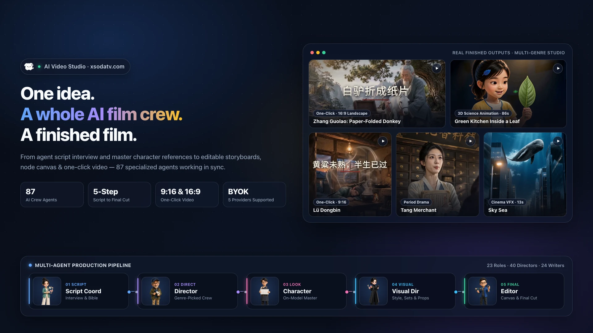
</a>

Nothing to install or deploy — open **[xsodatv.com](https://www.xsodatv.com)** in your browser to experience SodaTV right away.

> The SodaTV interface is currently in Chinese. Where this guide refers to buttons and menus, the Chinese label is given in parentheses.

## Why SodaTV

- **Start from an idea.** No screenwriting needed. An agent interviews you about the story, the lead, the style and the length, then writes a full script. You can also import a script you already have, or hand it a reference clip to adapt. → [Full walkthrough](#from-idea-to-film-a-full-walkthrough)
- **A whole AI crew.** 23 production roles, 40 directors and 24 screenwriters. Script coordinator, visual director, character, costume, makeup, location and prop designers, storyboard director, editor, consistency checker: each role owns its part, just like a real crew. → [The AI crew](#the-ai-crew)
- **Directors and writers picked for the genre.** Before production starts, the production coordinator hires 1–3 directors and a matching writers' room for the genre. Each segment goes to the director best suited to that kind of scene. → [Directors and writers](#the-ai-crew)
- **Characters stay on-model.** Characters and sets get a master reference first. You mark one as the primary pick (主选), every later shot is generated from it, and a consistency checker reviews the whole series. → [Asset book](#more-features)
- **Change one thing, redo one thing.** The script expands into episodes → segments → shots. Change a line of dialogue and only that segment is recompiled and regenerated, not the whole film.
- **In a hurry? One-click video.** Hot news, myths and legends, topic animations (Remotion): give it a topic and get a finished video. → [One-Click Video](#one-click-video)
- **20+ genres out of the box.** Xianxia fantasy, romance, urban drama, sci-fi, preschool animation, post-apocalyptic myth, Grimm's tales, safety education, science explainers, memoir, plus a dozen ad categories (beauty, food, fashion, home, tech, pets, real estate, farm produce, agricultural supplies and machinery) and general promos.
- **Your models, your choice.** Use the platform's models and pay in Bubbles, or plug in your own Volcano Engine, Soda Channel (OpenRouter), MiniMax, Volcano Web Search or Alibaba Cloud Bailian keys and use your own quota. → [Models and API keys](#models-and-api-keys)

Here is how a film is organized in SodaTV:

```
A film
├── Script: agent interview → script → series bible
├── Production design: visual style · characters · costumes · makeup · sets · props
├── Asset book: master reference (marked as primary) → side · back · other angles
├── Storyboard
│   ├── Episode 1
│   │   ├── Segment 1: shot 1 · shot 2 · shot 3   ← change a line, redo only this segment
│   │   └── Segment 2: shot 1 · shot 2
│   └── Episode 2 …
└── Canvas: segment videos → final cut
```

## The AI crew

Every film is made by three groups: 23 production roles, 40 directors and 24 screenwriters. While a job runs, the task panel shows who is working on what.

<details open>
<summary><strong>Production roles (23)</strong></summary>

**Script & Coordination** (4)

<table>
  <tr>
    <td align="center" valign="top" width="150">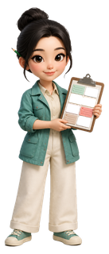<br><b>Script Coordinator</b><br><sub>Breaks down the script, builds the series bible</sub></td>
    <td align="center" valign="top" width="150"><br><b>Writers' Coordinator</b><br><sub>Tracks every character's lines</sub></td>
    <td align="center" valign="top" width="150"><br><b>Reference Analyst</b><br><sub>Reads your reference images and clips</sub></td>
    <td align="center" valign="top" width="150">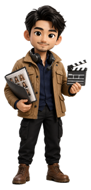<br><b>Production Coordinator</b><br><sub>Hires the crew, tracks production assets</sub></td>
  </tr>
</table>

**Art Department** (8)

<table>
  <tr>
    <td align="center" valign="top" width="150">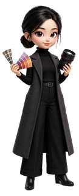<br><b>Visual Director</b><br><sub>Sets the film's visual style</sub></td>
    <td align="center" valign="top" width="150"><br><b>Character Designer</b><br><sub>Designs how characters look</sub></td>
    <td align="center" valign="top" width="150"><br><b>Costume Designer</b><br><sub>Dresses every character</sub></td>
    <td align="center" valign="top" width="150"><br><b>Makeup & Hair Designer</b><br><sub>Designs makeup and hair</sub></td>
  </tr>
  <tr>
    <td align="center" valign="top" width="150"><br><b>Accessory Designer</b><br><sub>Designs accessories</sub></td>
    <td align="center" valign="top" width="150">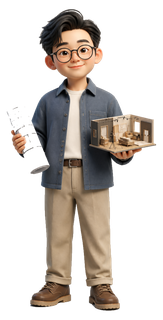<br><b>Location Designer</b><br><sub>Designs sets and locations</sub></td>
    <td align="center" valign="top" width="150">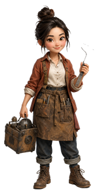<br><b>Prop Designer</b><br><sub>Designs key props</sub></td>
    <td align="center" valign="top" width="150">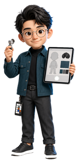<br><b>Appearance Checker</b><br><sub>Checks looks against your chosen reference</sub></td>
  </tr>
</table>

**Camera & Editing** (7)

<table>
  <tr>
    <td align="center" valign="top" width="150">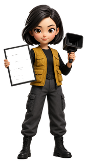<br><b>Storyboard Director</b><br><sub>Designs the storyboard</sub></td>
    <td align="center" valign="top" width="150">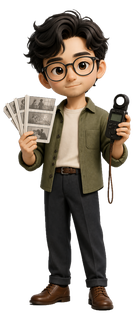<br><b>Shot Detail Writer</b><br><sub>Writes each shot's picture and performance</sub></td>
    <td align="center" valign="top" width="150"><br><b>First-Frame Engineer</b><br><sub>Composes each shot's first frame</sub></td>
    <td align="center" valign="top" width="150">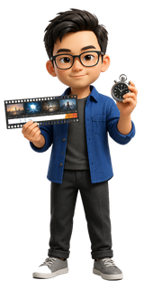<br><b>Editor</b><br><sub>Plans scenes, smooths transitions</sub></td>
  </tr>
  <tr>
    <td align="center" valign="top" width="150">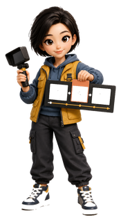<br><b>Pickup Director</b><br><sub>Fills in missing shots</sub></td>
    <td align="center" valign="top" width="150">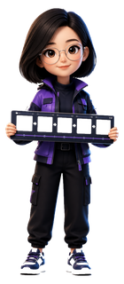<br><b>Video Prompt Engineer</b><br><sub>Compiles shots into video prompts</sub></td>
    <td align="center" valign="top" width="150">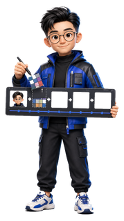<br><b>Video Prompt Reviser</b><br><sub>Updates looks when a reference changes</sub></td>
  </tr>
</table>

**Quality Control** (2)

<table>
  <tr>
    <td align="center" valign="top" width="150">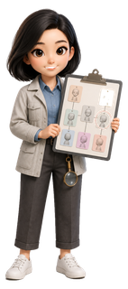<br><b>Consistency Checker</b><br><sub>Keeps characters on-model across the series</sub></td>
    <td align="center" valign="top" width="150"><br><b>Source Consistency Reviser</b><br><sub>Fixes drift from the source script</sub></td>
  </tr>
</table>

**One-Click Video** (2)

<table>
  <tr>
    <td align="center" valign="top" width="150"><br><b>News Researcher</b><br><sub>Gathers public reports and facts</sub></td>
    <td align="center" valign="top" width="150">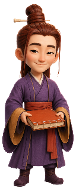<br><b>Folklore Researcher</b><br><sub>Traces classics and legend sources</sub></td>
  </tr>
</table>

</details>

<details open>
<summary><strong>Directors (40)</strong>: 1–3 are hired per film based on the genre, and each segment goes to the best fit</summary>

**Narrative Film** (18)

<table>
  <tr>
    <td align="center" valign="top" width="150"><br><b>Steven Spielberg</b><br><sub>Staging and emotional clarity</sub></td>
    <td align="center" valign="top" width="150">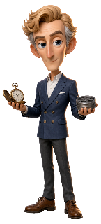<br><b>Christopher Nolan</b><br><sub>Time structures and cross-cutting</sub></td>
    <td align="center" valign="top" width="150">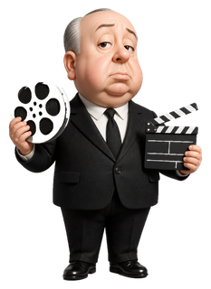<br><b>Alfred Hitchcock</b><br><sub>The grammar of suspense</sub></td>
    <td align="center" valign="top" width="150"><br><b>David Fincher</b><br><sub>Precision and cool restraint</sub></td>
    <td align="center" valign="top" width="150">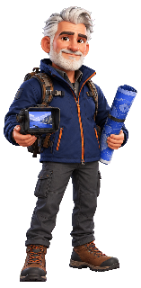<br><b>James Cameron</b><br><sub>Machines and countdowns</sub></td>
  </tr>
  <tr>
    <td align="center" valign="top" width="150">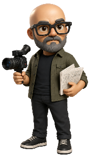<br><b>Denis Villeneuve</b><br><sub>Monumental scale and silence</sub></td>
    <td align="center" valign="top" width="150">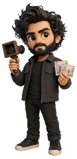<br><b>Robert Eggers</b><br><sub>Folklore with a realist core</sub></td>
    <td align="center" valign="top" width="150"><br><b>Matteo Garrone</b><br><sub>Fairy tales shot as real life</sub></td>
    <td align="center" valign="top" width="150">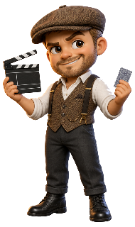<br><b>Guy Ritchie</b><br><sub>Ensemble schemes and showdowns</sub></td>
    <td align="center" valign="top" width="150">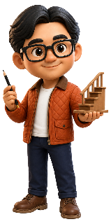<br><b>Bong Joon-ho</b><br><sub>Class written into up and down</sub></td>
  </tr>
  <tr>
    <td align="center" valign="top" width="150"><br><b>Hirokazu Kore-eda</b><br><sub>The flow of everyday life</sub></td>
    <td align="center" valign="top" width="150"><br><b>Shunji Iwai</b><br><sub>Backlight and youth</sub></td>
    <td align="center" valign="top" width="150">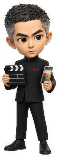<br><b>Zhang Yimou</b><br><sub>Color fields and ritual</sub></td>
    <td align="center" valign="top" width="150">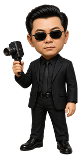<br><b>Wong Kar-wai</b><br><sub>Mood and atmosphere</sub></td>
    <td align="center" valign="top" width="150"><br><b>Ang Lee</b><br><sub>Restrained family drama</sub></td>
  </tr>
  <tr>
    <td align="center" valign="top" width="150">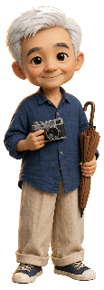<br><b>Hou Hsiao-hsien</b><br><sub>Static long takes through doorways</sub></td>
    <td align="center" valign="top" width="150">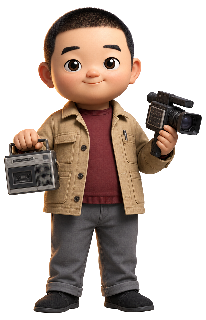<br><b>Jia Zhangke</b><br><sub>Fixed wide shots of stations and streets</sub></td>
    <td align="center" valign="top" width="150">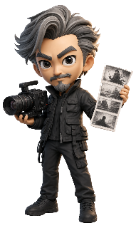<br><b>Tsui Hark</b><br><sub>Momentum and spectacle</sub></td>
  </tr>
</table>

**Commercials** (10)

<table>
  <tr>
    <td align="center" valign="top" width="150">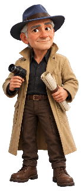<br><b>Ridley Scott</b><br><sub>The product hero shot</sub></td>
    <td align="center" valign="top" width="150"><br><b>Spike Jonze</b><br><sub>Spaces that bend with emotion</sub></td>
    <td align="center" valign="top" width="150">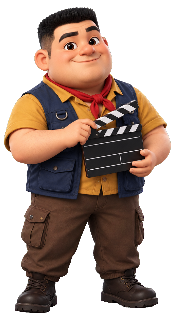<br><b>Tom Kuntz</b><br><sub>One-take monologues to camera</sub></td>
    <td align="center" valign="top" width="150"><br><b>Dougal Wilson</b><br><sub>Waiting as the drama</sub></td>
    <td align="center" valign="top" width="150"><br><b>Jake Scott</b><br><sub>One gesture, repeated three times</sub></td>
  </tr>
  <tr>
    <td align="center" valign="top" width="150">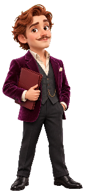<br><b>Joe Wright</b><br><sub>Long takes that follow a decision</sub></td>
    <td align="center" valign="top" width="150">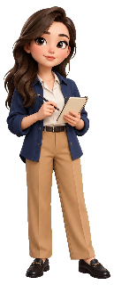<br><b>Sofia Coppola</b><br><sub>Ease in natural light</sub></td>
    <td align="center" valign="top" width="150"><br><b>Sølve Sundsbø</b><br><sub>Texture as the hero</sub></td>
    <td align="center" valign="top" width="150">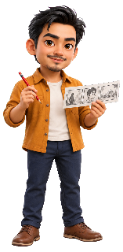<br><b>Thanonchai Sornsriwichai</b><br><sub>Everyday kindness, unexplained</sub></td>
    <td align="center" valign="top" width="150">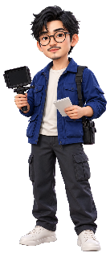<br><b>Zhang Dapeng</b><br><sub>Humble objects, premium shots</sub></td>
  </tr>
</table>

**Documentary & Explainer** (5)

<table>
  <tr>
    <td align="center" valign="top" width="150">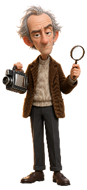<br><b>Errol Morris</b><br><sub>Lit evidence against black</sub></td>
    <td align="center" valign="top" width="150">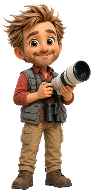<br><b>Alastair Fothergill</b><br><sub>Patient establishing shots and macro</sub></td>
    <td align="center" valign="top" width="150">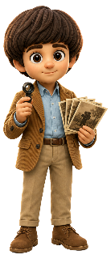<br><b>Ken Burns</b><br><sub>Pans and pushes over stills</sub></td>
    <td align="center" valign="top" width="150">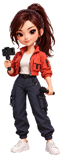<br><b>Creator Talking Head</b><br><sub>Feed-native creator to camera</sub></td>
    <td align="center" valign="top" width="150">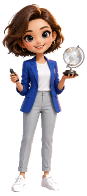<br><b>Explainer Host</b><br><sub>Explains to camera, never sells</sub></td>
  </tr>
</table>

**Animation & Kids** (7)

<table>
  <tr>
    <td align="center" valign="top" width="150">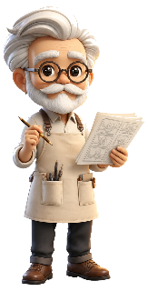<br><b>Hayao Miyazaki</b><br><sub>Wind, flight, and nature's scale</sub></td>
    <td align="center" valign="top" width="150"><br><b>Pete Docter</b><br><sub>Abstract ideas turned into characters</sub></td>
    <td align="center" valign="top" width="150">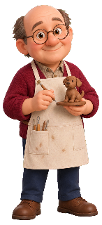<br><b>Nick Park</b><br><sub>Human voices on animal faces</sub></td>
    <td align="center" valign="top" width="150">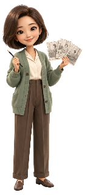<br><b>Gentle Daily</b><br><sub>Small everyday moments for preschoolers</sub></td>
  </tr>
  <tr>
    <td align="center" valign="top" width="150">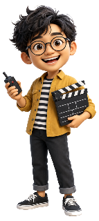<br><b>Playful Gag</b><br><sub>Harmless slapstick</sub></td>
    <td align="center" valign="top" width="150">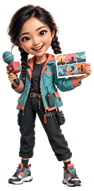<br><b>Sing-Along</b><br><sub>Repeat, sing, and move together</sub></td>
    <td align="center" valign="top" width="150"><br><b>Soft Wonder</b><br><sub>Imagination made visible</sub></td>
  </tr>
</table>

</details>

<details open>
<summary><strong>Screenwriters (24)</strong>: also picked by genre, responsible for adaptation and dialogue</summary>

**Screen** (6)

<table>
  <tr>
    <td align="center" valign="top" width="150">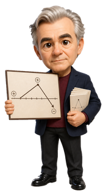<br><b>Robert McKee</b><br><sub>Every scene turns a value</sub></td>
    <td align="center" valign="top" width="150">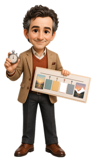<br><b>Blake Snyder</b><br><sub>The beat sheet</sub></td>
    <td align="center" valign="top" width="150"><br><b>Aaron Sorkin</b><br><sub>Dialogue as action</sub></td>
  </tr>
  <tr>
    <td align="center" valign="top" width="150"><br><b>Quentin Tarantino</b><br><sub>The audience knows, the characters don't</sub></td>
    <td align="center" valign="top" width="150"><br><b>Liu Heping</b><br><sub>Subtext and power plays</sub></td>
    <td align="center" valign="top" width="150">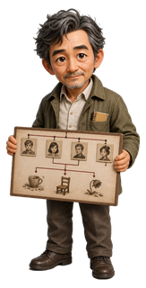<br><b>Lu Wei</b><br><sub>Plot grows out of character</sub></td>
  </tr>
</table>

**Advertising** (8)

<table>
  <tr>
    <td align="center" valign="top" width="150">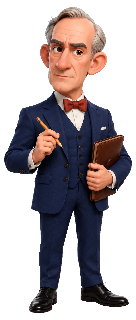<br><b>David Ogilvy</b><br><sub>Claims you can verify</sub></td>
    <td align="center" valign="top" width="150">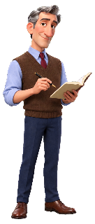<br><b>Bill Bernbach</b><br><sub>One insight, one line</sub></td>
    <td align="center" valign="top" width="150">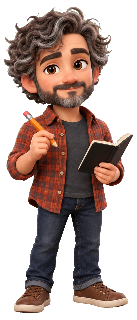<br><b>Dan Wieden</b><br><sub>Talk about the audience, not the brand</sub></td>
    <td align="center" valign="top" width="150"><br><b>Ilon Specht</b><br><sub>First-person attitude lines</sub></td>
  </tr>
  <tr>
    <td align="center" valign="top" width="150"><br><b>Shirley Polykoff</b><br><sub>Saying the unsaid, playfully</sub></td>
    <td align="center" valign="top" width="150">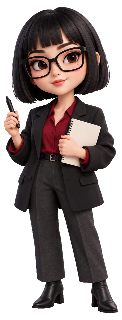<br><b>Hsu Shun-ying</b><br><sub>Sell a way of living</sub></td>
    <td align="center" valign="top" width="150"><br><b>Dong Dongqiang</b><br><sub>Ads are spoken, not written</sub></td>
    <td align="center" valign="top" width="150"><br><b>Shigesato Itoi</b><br><sub>Soft, everyday speech</sub></td>
  </tr>
</table>

**Science & Nonfiction** (5)

<table>
  <tr>
    <td align="center" valign="top" width="150"><br><b>Richard Feynman</b><br><sub>First principles plus an analogy</sub></td>
    <td align="center" valign="top" width="150"><br><b>Carl Sagan</b><br><sub>Puts you at cosmic scale</sub></td>
    <td align="center" valign="top" width="150"><br><b>Randall Munroe</b><br><sub>Absurd what-ifs, taken seriously</sub></td>
    <td align="center" valign="top" width="150"><br><b>Steven Johnson</b><br><sub>Inventions grow from the adjacent possible</sub></td>
    <td align="center" valign="top" width="150"><br><b>Ye Yonglie</b><br><sub>Starts from a child's question</sub></td>
  </tr>
</table>

**Essay & Memoir** (5)

<table>
  <tr>
    <td align="center" valign="top" width="150"><br><b>Zhu Ziqing</b><br><sub>One gesture per paragraph</sub></td>
    <td align="center" valign="top" width="150"><br><b>Shi Tiesheng</b><br><sub>A person seen through a place</sub></td>
    <td align="center" valign="top" width="150"><br><b>Lung Ying-tai</b><br><sub>Second person, both directions</sub></td>
    <td align="center" valign="top" width="150"><br><b>Annie Ernaux</b><br><sub>Starts from a photograph</sub></td>
    <td align="center" valign="top" width="150"><br><b>Natalia Ginzburg</b><br><sub>Family sayings as family history</sub></td>
  </tr>
</table>

</details>

> The director and screenwriter profiles are working methods we distilled from each creator's publicly available work, used to guide storyboarding, performance and writing. They are not affiliated with, endorsed by, or created with the people they are named after.
>
> **Copyright notice**: All 87 chibi/Q-style AI crew character illustrations above are original SodaTV artwork (All Rights Reserved). Copying, modifying, redistributing, commercial use, or model training without prior written permission is prohibited. See [LICENSE](LICENSE).

## One-Click Video

Don't want to go step by step? Use One-Click Video: on the canvas, open **One-Click Video (一键成片)**, pick a format, give it a topic, and the crew does the rest.

| Format | You give | You get |
| --- | --- | --- |
| **Hot News (热点新闻)** | A topic you care about | Public reports gathered into a sourced script, read by an AI anchor, with visuals and subtitles, as a vertical news clip |
| **Myths & Legends (玄幻讲解)** | A myth or legend | A complete story told segment by segment, with Chinese-style illustrations brought to life in vertical (9:16) or landscape (16:9), with narration, sound effects and subtitles |
| **Topic Animation (`Remotion` in the menu)** | A topic | Research, a script, then a freshly written animation; every job gets its own palette and visual style |

<table>
<tr>
<td width="33%" valign="top">

https://github.com/user-attachments/assets/6ecdc2a3-fe9d-4afa-97e1-9cc1bc9aaae5

<h3>🗡️ A Millet Dream: Lü Dongbin Seeks the Dao</h3>
<p><sub>Myths & Legends · 122 s vertical · Chinese narration</sub></p>
<p>On his way to the imperial exam, scholar Lü Yan stops at an inn on the Handan road and turns down Zhongli Quan's call to seek the Dao. Before a single pot of millet finishes cooking, he dreams a lifetime of top-scholar glory and snowy tragedy, waking to find every figure in the dream was Zhongli Quan in disguise. Characters, illustrations, motion, narration, sound effects and subtitles are all generated automatically.</p>

</td>
<td width="33%" valign="top">

https://github.com/user-attachments/assets/d1a90768-a801-4827-8f75-17fdaef3be24

<h3>🐉 Hetu & Luoshu: The Dragon Horse and the Divine Turtle</h3>
<p><sub>Myths & Legends · 98 s vertical · Chinese narration</sub></p>
<p>A dragon horse rises from the Yellow River bearing the Hetu diagram, Fuxi draws the Eight Trigrams from it, a divine turtle brings the Luoshu out of the Luo River, and Yu the Great uses it to set the Nine Principles of governance. One ancient legend, told end to end, with illustrations, motion, narration, subtitles and captions all generated automatically.</p>

</td>
<td width="33%" valign="top">

https://github.com/user-attachments/assets/1a7323b7-dd67-4d92-bd14-208a1954f1b1

<h3>📰 Florida Business Jet Crash: Latest</h3>
<p><sub>Hot News · 118 s vertical · Chinese narration</sub></p>
<p>Several public reports gathered into one script and read by an AI anchor. Where outlets disagree, both accounts are shown side by side; the story is laid out as what happened, the investigation and the impact. On-scene footage comes from public reports; info cards, the flight-path map and subtitles are generated automatically.</p>

</td>
</tr>
<tr>
<td colspan="3" valign="top">

https://github.com/user-attachments/assets/09e201d7-47fc-4d2e-8e92-4b8f26e42abe

<h3>🫏 Zhang Guolao: The Paper-Folded White Donkey</h3>
<p><sub>Myths & Legends · 128 s landscape (16:9) · Chinese narration</sub></p>
<p>The eccentric hermit Zhang Guo of Mount Zhongtiao rides his white donkey backward for hundreds of miles a day, folding it flat like paper into a traveling chest whenever he rests. Summoned by Empress Wu Zetian he feigns death outside a temple and reappears in the mountains; summoned by Emperor Xuanzong he collapses on the spot until incense is burned for the imperial edict, finally riding into Luoyang. Generated in 16:9 widescreen with consistent characters, scenes, narration, sound effects and subtitles.</p>

</td>
</tr>
</table>

## From idea to film: a full walkthrough

Here is how the short *Visitors from the Sea of Clouds* went from an idea to a finished film in five steps. The story is simple: a young pilot and her puppy fly an airship across a sea of clouds and find a floating castle.

<table>
  <tr>
    <td width="42%"></td>
    <td>
      <h3>1. Script</h3>
      <p>Tell the agent "a girl and her puppy go on an airship adventure". It asks who the lead is, what style you want and how long the film should be, then writes a script from your answers.</p>
      <p>You check the motivations, the turns and the dialogue, and lock the story.</p>
      <p><b>Result:</b> a script ready for design.</p>
    </td>
  </tr>
  <tr>
    <td></td>
    <td>
      <h3>2. The crew reads the script</h3>
      <p>The director and screenwriter work through the plot, relationships and emotional rhythm. Costume, set and prop designers detail the girl's flight gear, the puppy's collar, the airship and the floating castle.</p>
      <p>The overall style and look are set first, so every department designs toward the same visual direction.</p>
      <p><b>Result:</b> a consistent production design and asset list.</p>
    </td>
  </tr>
  <tr>
    <td></td>
    <td>
      <h3>3. Asset book</h3>
      <p>Generate turnaround candidates for the girl and the puppy, then mark one as primary (主选). The side and back views, and every shot after that, are generated from it.</p>
      <p>Not happy with a look? Edit the asset prompt and generate again.</p>
      <p><b>Result:</b> character and set references that carry through the whole film.</p>
    </td>
  </tr>
  <tr>
    <td></td>
    <td>
      <h3>4. Storyboard</h3>
      <p>The script expands into segments and shots: a wide shot of the clouds and the airship, a close-up for the girl's line, an insert of the puppy's reaction.</p>
      <p>Edit any shot you don't like, then click Compile segment (编译本段). Preview frames let you check composition and characters before generating video.</p>
      <p><b>Result:</b> an editable storyboard with previews.</p>
    </td>
  </tr>
  <tr>
    <td></td>
    <td>
      <h3>5. Generate on the canvas</h3>
      <p>Add the segments to the canvas, wire the character and set references into the video nodes, confirm the prompts, and generate.</p>
      <p>Review each segment for characters, action and continuity, redo what needs work, then assemble the final cut.</p>
      <p><b>Final film:</b> play <i>Visitors from the Sea of Clouds</i> (5 s) inline in the <a href="#showcase">Showcase</a> below.</p>
    </td>
  </tr>
</table>

**Tip for your first project**: start with a short story with few characters and few locations. Polish one segment until the style and pacing feel right, then move on to the rest.

## Showcase

Every video below was generated with SodaTV and is AI-generated content. Press play right on the page.

<table>
<tr>
<td width="270" valign="top">

https://github.com/user-attachments/assets/283ce08e-3cfd-4388-851b-575828ee4d7c

<p><b>The Green Kitchen Inside a Leaf</b> · Kids' science animation · 86 s with sound (Chinese)</p>
<p>Holding a fresh green leaf on a miniature science stage, a young animated host shows children how water travels up a tree trunk and into the leaf's "green kitchen" for photosynthesis, keeping character design, outfit and set consistent across every shot.</p>

</td>
<td width="270" valign="top">

https://github.com/user-attachments/assets/0205769e-45f9-4643-9467-96b193ced02c

<p><b>The Ginger Cat's Rolling Throne</b> · Comedy animation · 22 s with sound</p>
<p>A robot vacuum becomes a private ride, and a ginger cat sets off on a lazy yet lordly living-room adventure.</p>

</td>
<td width="270" valign="top">

https://github.com/user-attachments/assets/0b369b74-2265-413e-88a9-f116b378be16

<p><b>Reunion Above the Clouds</b> · Future drama · 12 s with sound</p>
<p>Crossing a sky station at sunset, she stops at the train door for a reunion within arm's reach.</p>

</td>
</tr>
<tr>
<td width="270" valign="top">

https://github.com/user-attachments/assets/f3548fda-9a05-4ddc-873e-a53af6ab054e

<p><b>Visitors from the Sea of Clouds</b> · Adventure animation · 5 s with sound</p>
<p>The airship skims past a floating rock as the castle gate ahead slowly opens. This is the film from the walkthrough above.</p>

</td>
<td width="270" valign="top">

https://github.com/user-attachments/assets/225e0c04-edae-4639-9eb1-d38c06b22c15

<p><b>After the Start</b> · Sports ad · 6 s with sound</p>
<p>Spikes splash into shallow water and drive forward; a low tracking shot puts the power into every footfall.</p>

</td>
<td width="270" valign="top">

https://github.com/user-attachments/assets/3b04d3f8-3faa-4a83-b404-44d3ffb28bd5

<p><b>Wind Through Summer</b> · Commercial · 5 s with sound</p>
<p>At sunset a breeze lifts her hair; she turns toward footsteps on the grass and smiles.</p>

</td>
</tr>
<tr>
<td width="270" valign="top">

https://github.com/user-attachments/assets/29487a64-f3f7-4e84-82b5-a56404baa683

<p><b>Tang Dynasty Merchant Lady</b> · Period drama · 10 s with sound (Chinese)</p>
<p>Episode 1, segment 1: across the counter of Su's Spice Shop, a young shopkeeper clutching her account ledgers faces down a wealthy creditor with consistent lip-sync, shot-reverse-shot framing and Tang-era set detail.</p>

</td>
<td width="270" valign="top">

https://github.com/user-attachments/assets/d4ef688e-adde-4be5-9f51-b299494f9bc6

<p><b>Fertilizer That Stands Up to Scrutiny</b> · Agricultural ad · 14 s with sound</p>
<p>Episode 1, segment 1 of an ad made end to end from a script: a farmer in the field scoops up a handful of organic fertilizer and starts talking to camera.</p>

</td>
<td width="270" valign="top">

https://github.com/user-attachments/assets/2e35fcfd-7953-49bf-a715-2280a84e3acb

<p><b>Motion Transfer</b> · Canvas workflow (internal beta) · 10 s with sound</p>
<p>One character image plus one motion reference clip: the character performs the full dance routine with consistent identity, expression, outfit and lighting.</p>

</td>
</tr>
<tr>
<td width="270" valign="top">

https://github.com/user-attachments/assets/f5df9c5b-c2de-45a6-880c-28e248e78c16

<p><b>Sky Sea</b> · Cinematic spectacle · 13 s with sound</p>
<p>On a rain-washed street, a woman waiting at a crossing looks up to find the sky has become an inverted ocean, with a whale gliding over the skyscrapers.</p>

</td>
<td width="270" valign="top">

https://github.com/user-attachments/assets/7ed84ce8-959f-4c5e-a4c1-64c84f81e1eb

<p><b>Fresh Before Close</b> · Light comedy · 15 s ad with sound</p>
<p>A bedtime moment turned into a playful exchange: a fresh little story told in fifteen seconds.</p>

</td>
</tr>
</table>

## More features

| Feature | What you can do |
| --- | --- |
| **Node canvas** | Wire character and set references into video nodes, then generate, preview, redo, and assemble the final cut. |
| **Asset book** | Characters start with a turnaround and sets with a master angle. Mark one as primary (主选), then add side, back and other views. You can also upload your own image as the reference. |
| **Storyboard** | Edit picture descriptions, dialogue and shot plans, then click Compile segment (编译本段). Preview frames and a readiness check show what a segment still needs before you generate video. |
| **Asset library** | Organize assets in folders. Generated results stay on the canvas until you keep them, so your library isn't flooded with candidates. |
| **Collaboration** | Invite members as Owner, Editor or Viewer, comment on the canvas, and create read-only share links you can revoke at any time. |

## Models and API keys

There are two ways to use SodaTV, and you can mix them:

| Mode | How to start | How you pay |
| --- | --- | --- |
| **Platform models** (default) | Sign up and start; no key needed | Pay in Bubbles; each generation shows its estimated cost first |
| **Bring your own key** | Account Center (账户中心) → Model API Key (模型 API Key), then add your key | Services with your key use your own quota and **cost no Bubbles**; the provider bills you directly |

Keys are configured per provider. If you only add a Volcano Engine key, generations that go through Volcano Engine use your quota and everything else still runs on platform models billed in Bubbles.

**Account Center (账户中心) → Account (账户) → Model API Key (模型 API Key)** currently supports **5 provider cards**:

| Card in UI | What it covers |
| --- | --- |
| **Volcano Engine (火山引擎)** | One Volcano Engine IAM API key with Ark + Doubao Speech permissions covers Ark models, speech recognition (ASR) and text-to-speech (TTS) |
| **Soda Channel (Soda 通道)** | Accepts an OpenRouter API key; Soda Channel can reuse OpenRouter |
| **MiniMax** | MiniMax China Open Platform API key for **MiniMax H3 (official direct)** video generation (models routed via Soda Channel use your Soda Channel / OpenRouter key) |
| **Volcano Web Search (火山联网搜索)** | Dedicated Doubao Search Custom API key for web research in Hot News and Topic Animation |
| **Alibaba Cloud Bailian (阿里云百炼（一键成片配音）)** | Voiceover for One-Click Video (Myths & Legends narration and Hot News female anchor); a Volcano Engine speech key does not replace it, and without it voiceovers still bill in Bubbles |

<details open>
<summary><strong>Add a Volcano Engine key (Ark + Doubao Speech)</strong></summary>

1. In the Volcano Engine IAM console, create an API key, grant the user Ark and Doubao Speech permissions, and enable the model and speech services you need (an existing Ark key can also be granted Speech permissions in IAM).
2. Sign in at [xsodatv.com](https://xsodatv.com) and open **Account Center (账户中心) → Account (账户) → Model API Key (模型 API Key)**.
3. On the **Volcano Engine (火山引擎)** card, paste the API key and click **Save and verify (保存并验证)**.
4. Verification checks Ark, ASR and TTS separately (TTS synthesizes one character, using a tiny amount of your provider quota and zero Bubbles). If any check fails, the card shows the reason; enable the missing permission or model and click **Verify again (重新验证)**.

</details>

<details>
<summary><strong>Add a Soda Channel (OpenRouter) key</strong></summary>

1. Create an API key on OpenRouter and make sure your account has credit.
2. In **Account Center (账户中心) → Account (账户) → Model API Key (模型 API Key)**, open the **Soda Channel (Soda 通道)** card and paste your OpenRouter API key (Soda Channel can reuse OpenRouter), then click **Save and verify (保存并验证)**.
3. Verification only queries key status and does not generate content.

</details>

<details>
<summary><strong>Add a MiniMax key</strong></summary>

1. Sign in to the MiniMax China Open Platform console, create an API key under Account Management / API Keys, and ensure video generation is enabled.
2. Paste it into the **MiniMax** card and click **Save and verify (保存并验证)** (verification only reads voice lists without generating video; video permissions and credit are checked when generating).
3. Select **MiniMax H3 (官方直连)** to use this key; options routed through **Soda Channel (Soda 通道)** use your Soda Channel / OpenRouter key.

</details>

<details>
<summary><strong>Add a Volcano Web Search key</strong></summary>

1. In the Volcano Engine Web Search console, open API Key Management, choose pay-as-you-go or a subscription plan, and create a Doubao Search Custom API key.
2. Paste it into the **Volcano Web Search (火山联网搜索)** card and click **Save and verify (保存并验证)** (verification runs one test search billed to your Volcano Engine account, zero Bubbles).

</details>

<details>
<summary><strong>Add an Alibaba Cloud Bailian key (One-Click Video voiceover)</strong></summary>

1. In the Alibaba Cloud Bailian console (Beijing region), create an API key and enable the `qwen-audio` speech synthesis model.
2. Paste it into the **Alibaba Cloud Bailian (阿里云百炼（一键成片配音）)** card and click **Save and verify (保存并验证)** (verification synthesizes one character using the narrator voice, billed to your Alibaba Cloud account).
3. **Note**: One-Click Video voiceovers (Myths & Legends narration and Hot News female voice) run on Bailian; adding only a Volcano Engine key does not waive Bubbles for these voiceovers.

</details>

<details>
<summary><strong>Optional: use real faces as references</strong></summary>

Volcano Engine's virtual avatar library is separate for each account. If you generate with your own Volcano Engine key and want to use a real person's face as a reference, expand the advanced options on the **Volcano Engine (火山引擎)** card to add a Volcano Engine IAM AK/SK pair and enable virtual avatars in the Volcano Engine console. Then click **I've enabled it, check again (我已开通，重新检测)**.

One generation uses up to 9 reference images. If your avatar group runs out of space, you can allow SodaTV to automatically clean up old avatars that are not in use. Only upload your own face or faces you are authorized to use.

</details>

Good to know:

- **The generate button shows who pays.** Jobs on your own key are marked "this job uses your own API key, no Bubbles charged".
- **A failed key never silently falls back to platform credit.** Generations for that provider will prompt you to fix the key instead of charging Bubbles.
- **Keys are stored encrypted and never shown again.** The interface only shows the last four characters, and there is no way to view the full key.
- **You can delete a key at any time.** That provider then goes back to platform models billed in Bubbles; jobs running on that key may need to be restarted.
- Costs on your own key follow the provider's bill. SodaTV does not handle those charges.

## Feedback

- **Website**: [xsodatv.com](https://xsodatv.com)
- **Bugs and ideas**: found a problem or want a feature? [Open an issue](https://github.com/burning0xb-creator/xsodatv/issues/new). Tell us which page you were on, what you did, what you saw versus what you expected, and roughly when; screenshots or screen recordings help a lot.
- Please don't post phone numbers, order numbers or API keys in issues. Issues are public.

## Copyright & Usage

Copyright © 2026 SodaTV. All Rights Reserved.

All original visual assets in this repository — including all **87 chibi/Q-style AI crew character illustrations** (`assets/team/`), brand marks and mascots (`assets/brand/`), hero and workflow artwork (`assets/hero.webp`, `assets/workflow/`), showcase thumbnails and embedded demo videos — are the proprietary property of SodaTV. Copying, modifying, creating derivative works, commercial use, redistribution, or AI/ML model training without prior written permission from SodaTV is strictly prohibited. See [LICENSE](LICENSE).
